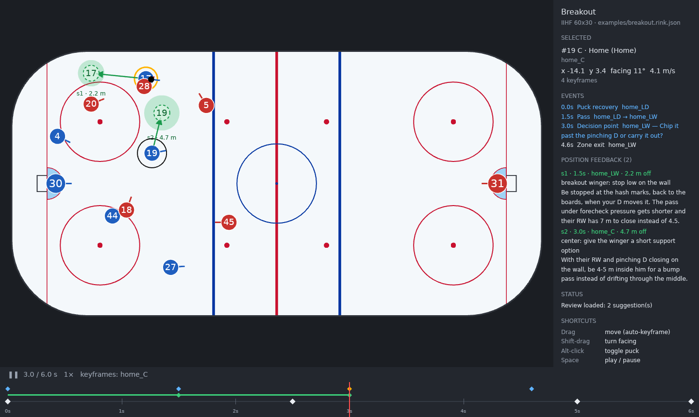

# Rink Replay

A desktop app for recreating real hockey plays as keyframed 2D animations on a to-scale, top-down rink. Your
Claude Code agent then reviews your positioning ("at that moment you should have been there"). The suggestion
appears on the rink as a ghost skating the better route.



**Using it: read the [manual](docs/MANUAL.md).** It covers retracing a play, reviews, working with Claude Code,
and every shortcut.

Plan: [Rink Replay — Hockey Play Animator (Plan)](https://claude.ai/artifact/9v9NCszp1ViTAkhPhGwC1m)

## Status

| Milestone | State |
| --- | --- |
| M0 · Spike: GPUI window, IIHF rink drawn to scale, drag a player | Done |
| M1 · Core + playback: `rink-core` model, `sample()`, keyframes, scrub, play/pause | Done |
| M2 · Editor: multi-row timeline, event editing, templates UI, undo, autosave | Done: text fields, event and roster editing, all-players timeline, play picker, undo/redo, autosave with conflict handling |
| Position feedback: facts, `rink` CLI, Claude Code skill, ghosts in the app | Done (replaces the planned MCP server for now) |
| Web app: the rink through WebAssembly in a Svelte app ([design](docs/web-app-design.md), [experience](docs/web-app-experience.md)) | In progress: lesson player (Phase 1) for L1 to L4, progress in the browser, installable and offline; play viewer |

## Layout

```text
crates/
  rink-core/   # model, rink geometry, interpolation (sample), validation, file format, templates
  rink-lesson/ # lessons over plays: the lesson and step model, grading, content checks
  rink-app/    # GPUI binary: rink-replay
  rink-cli/    # `rink`: JSON facts, timelines and position reviews for agents
  rink-footage/ # extract timestamped JPEGs from HEVC footage for manual tracing
  rink-wasm/   # rink-core and rink-lesson for the browser: play and lesson handles, scene, hit test, grading
web/           # Svelte app (Vite): lesson player and play viewer over rink-wasm
curriculum/    # the courses: courses.json, lessons (Markdown + steps JSON), plays, glossary.json, STYLE.md
extensions/    # swamp: the @vilbergs/curriculum lint behavior and its summary report
workflows/     # swamp: web-build, deploy-pi, curriculum-check
rinks/         # rink presets (IIHF 60x30, NHL 61x26) as JSON
examples/      # breakout play with an example review
.claude/skills/   # Claude Code skills: review-positioning, draft-play
```

`rink-core` has no UI dependency. `sample(play, t_ms) -> Snapshot` is the one function that turns keyframes into
positions. The renderer and the `rink` CLI both use it, so the app and Claude can't disagree about where anyone
was.

## Model in brief

- Rink coordinates are meters with the origin at center ice. +x is home's attacking direction and +y is home's
  left. Time is in milliseconds.
- Skater paths use centripetal Catmull-Rom splines through the keyframes. Facing turns along the shortest arc
  between keyframes that set it; otherwise a skater faces their direction of travel.
- Possession comes only from events, the way you remember a play:
  - a `puck_recovery` gives the puck to a player;
  - a `pass` releases it and the receiver gets it on arrival, unless someone intercepts it first;
  - a `shot` or `whistle` makes it loose;
  - a `turnover` takes it away and can give it to an opponent.

  A loose puck moves in a straight line from its release point to the next pickup, through any puck keyframes on
  the way. In the app, Alt-click a player to give them the puck: it adds a pass from a teammate, a turnover from
  an opponent, or a recovery of a loose puck.
- A play can carry a transcript: `captions`, each a `t_ms` and a text that shows under the rink until the next
  one. A decision point can carry an `answer` that stays hidden until you press A. `rink transcript <play> --md`
  prints both as a Markdown table, so lesson notes embed the play's own text instead of a copy.
- Each play is saved as one `.rink.json` file with a `schema_version`. Older files are upgraded when loaded, and
  `rink upgrade <play>` rewrites one in the current format. Snapshots are always derived and never saved.
- Each suggestion records a fingerprint of the play's motion. If you edit the play afterwards, the app greys out
  that ghost and marks it "play edited since", and `rink review` reports `"stale": true`. Then ask for a fresh
  review.

## Recreate a play from footage

`rink-footage` extracts upright JPEGs from HEVC MOV and MP4 clips using Rust. The arguments after the
output directory are the longest image edge in pixels and one or more source timestamps in milliseconds.
The command prints the presentation time of each saved frame.

```sh
cargo run --release -p rink-footage -- ~/Documents/Footage/IMG_2900.MOV /tmp/rink-frames 1200 5000 6000 7000
cargo run -q -p rink-cli -- check examples/footage/img-2900-corner-turn.rink.json
cargo run --release -p rink-app -- examples/footage/img-2900-corner-turn.rink.json
```

Use visible landmarks to estimate skater positions in rink meters, then record them as keyframes at
times relative to the start of the replay. Add captions where the angle or an obstruction makes the
trace uncertain. Pass the resulting `.rink.json` to the desktop app to open it.
The [workflow diagram](docs/footage-workflow.svg) shows how this produced the
[corner-turn replay](examples/footage/img-2900-corner-turn.rink.json).

### Import footage in Rink Replay

Choose **File → Footage Sessions…** (⌘⇧O), or click **Footage** in the toolbar. Drop a batch of
HEVC MOV or MP4 files into the panel or select them with **Import Footage…**. The app copies
the originals into the local library's `footage/` folder and shows an upright start frame
and duration for each clip. Reopen **Footage Sessions…** to return to a saved batch.
Tracking and coaching exports still use the commands below.

### Preview skater tracking

`rink-track-preview` overlays a baseline color-patch tracker on extracted footage. The first CSV
point for each skater seeds the tracker. Later points are manual checks that never update its
predictions. Leave both coordinate fields blank to mark a check where the skater is off screen.
The preview briefly holds each check frame and displays the distance in image pixels.

The following example uses the [IMG_2896 checkpoints](examples/footage/img-2896-tracking.csv).
Run the extraction in a fresh output directory and supply a local TrueType font to the preview.

```sh
frames_dir="$(mktemp -d)"
frame_times=()
for ((i=0; i<135; i++)); do
  frame_times+=("$((3000 + (1000*i+7)/15))")
done
cargo run --release -p rink-footage -- ~/Documents/Footage/IMG_2896.MOV "$frames_dir" 900 "${frame_times[@]}"
mkdir -p artifacts/footage
cargo run --release -p rink-footage --features tracking-preview --bin rink-track-preview -- \
  "$frames_dir" IMG_2896 3000 12000 15 examples/footage/img-2896-tracking.csv \
  "/System/Library/Fonts/Supplemental/Arial.ttf" artifacts/footage/img-2896-cv-overlay.mp4
```

On macOS, use `--auto` to label skaters across a whole clip without supplying manual checkpoints.
It uses Apple's Vision person detector on the full frame and on overlapping crops of the rink, then
links detections by motion, overlap and jersey color. IDs start over in each clip and can change
after a missed detection or an occlusion. Dashed boxes
show short predictions between detections. The exported MP4 is silent.

```sh
frames_dir="$(mktemp -d)"
cargo run --release -p rink-footage -- ~/Documents/Footage/IMG_2900.MOV "$frames_dir" 900 --fps 15
mkdir -p artifacts/footage/skater-ids
cargo run --release -p rink-footage --features auto-tracking --bin rink-track-preview -- \
  --auto "$frames_dir" IMG_2900 15 "/System/Library/Fonts/Supplemental/Arial.ttf" \
  artifacts/footage/skater-ids/IMG_2900-skater-ids.mp4
```

For a coaching montage, extract upright source frames at 15 fps into one directory per
clip stem. Prepare a TSV with the header below and one row per play. Use a source start at a
whole second and mark the focus player in the JPEG nearest to the play's decision point.
Each play needs one current positioning suggestion in its adjacent `.review.json`.

```text
clip	start_ms	play	x1	y1	x2	y2	cue	condition
```

```sh
cargo run --release -p rink-footage --features coaching-montage --bin rink-track-preview -- \
  --montage "$frames_root" "$plays_dir" "$montage_tsv" "$font_path" "$output_mp4"
```

Supply an optional guides TSV after the output path to draw on the footage and hold additional
source frames. Coordinates refer to the upright JPEG. Guide kinds are `lane`, `reference`,
`adjustment`, `spacing`, and `player`. A `hold` row uses its label and detail as the coaching cue
and leaves the coordinates blank. Multiple rows can share one source timestamp.

```text
clip	source_ms	kind	x1	y1	x2	y2	label_x	label_y	label	detail
```

An output directory after the guides file also creates a Coaching Film Room. Open its
`index.html` locally to play the annotated `footage.mp4` above a full rink drawn from
rink-analyzer scenes. The timeline and feedback sidebar use the same video clock, including
freeze frames. Keep the exported files together when moving the room.

## Position feedback

1. **Retrace the play.** Retrace it in the app and mark the decision points (D). The app autosaves.
2. **Ask Claude Code.** In this repo, ask: "review my positioning in <play>". The `review-positioning` skill:
   - reads the play through the `rink` CLI, as computed facts such as zone, strong or weak side, above or below
     the puck, gaps and open pass lanes;
   - judges your positioning at the key moments;
   - writes suggestions to `<play>.review.json` with `rink suggest`.
3. **Every suggestion is checked before it's stored.** The spot must be on the ice and reachable from where you
   really were when the routes split, at 8 m/s or less. The command also prints the facts for where you were next
   to the facts for where you should have been, so you can see what the move changes.
4. **The app picks up the review while the play is open.** Each suggestion shows as a shaded zone at the target,
   a ghost skating the suggested route, an arrow from your real position, and a green bar on the timeline. N and
   Shift-N jump between suggestions, and G toggles ghosts.

Two Claude Code skills in `.claude/skills/` drive this loop:

| Skill | Ask Claude Code | Writes |
| --- | --- | --- |
| `review-positioning` | "review my positioning in <play>" | `<play>.review.json` through `rink suggest` |
| `draft-play` | "draft a play: D-zone breakout, I'm LW strong side, our D rims it and their D pinches" | a new `.rink.json` |

`rink compare` is a dry run: it shows the facts for any spot without saving anything. Use it to try a spot before
writing a suggestion.

```sh
cargo run -q -p rink-cli -- summary examples/breakout.rink.json
cargo run -q -p rink-cli -- snapshot examples/breakout.rink.json 3000
cargo run -q -p rink-app -- examples/breakout.rink.json      # shows the example review
```

## One window, driven by Claude Code

Keep one app window open and ask Claude Code to load or change plays in it: "show me the ideal version",
"open the breakout", "move their RD to the net front in this play". The agent works on the play files and
then tells the window to show the result:

```sh
rink current                                   # what the window shows: play, playhead, selection, unsaved edits
rink open <play> --at 5500 --select home_LW    # show a play at a moment; reloads it if it's already open
```

A link in a note does the same: `rink://open?play=<name>&at=<ms>&select=<entity id>`, where `<name>` is a library
play's file name without `.rink.json` (or a percent-encoded absolute path), and `at` and `select` are optional.
For example `rink://open?play=01-dzone-strong-side-wall&at=2500&select=home_LW`.

- `rink open` writes a request to `.open-request.json` in the library folder. The window checks for new requests
  every 0.75 s. If no window is running, `rink open` starts the app.
- A `rink://` link reaches the app as a macOS open-URL event, starting it if needed, and the app writes the same
  request. `scripts/install-mac.sh` registers the scheme for the installed `Rink Replay.app`; a binary started with
  `cargo run` doesn't receive links.
- The window doesn't watch play files. It reloads only on `rink open`, so an agent runs it once when it's done
  editing.
- The window autosaves about a second after the last edit, and never overwrites a file that changed on disk since
  it read it: then the edits go to `<play>.your-edits-<time>.rink.json` next to it and a banner asks which version
  to keep.
- The window writes what it shows to `.app-state.json` in the library folder, for `rink current`. With several
  windows open, they all follow every request; one window is the intended setup.

## Build and run

```sh
scripts/install-mac.sh                                 # Rink Replay.app in ~/Applications, rink in ~/.local/bin
cargo run -p rink-app --release                        # the play changed last, or a new breakout
cargo run -p rink-app --release -- --template faceoff  # faceoff | dzone | breakout
cargo run -p rink-app --release -- path/to/play.rink.json
cargo test --workspace                                 # includes headless UI tests on GPUI's test platform
```

Plays live in the library folder: `$RINK_REPLAY_LIBRARY` if set, otherwise `plays/` under the platform data
directory. `scripts/make-icon.sh` regenerates the app icon.

On Linux, GPUI needs these packages (Debian/Ubuntu names): `libxkbcommon-dev libxkbcommon-x11-dev
libwayland-dev libvulkan-dev libx11-xcb-dev libxcb1-dev libfontconfig-dev libfreetype-dev`, plus a Vulkan
driver.

`gpui` is pinned to `=0.2.2` from crates.io instead of a Zed git revision. `Cargo.lock` pins `libc` to 0.2.188
because gpui's `xattr` 0.2 dependency fails to compile against newer `libc` releases.

### Web app

The app in `web/` is a mobile-first lesson player over `curriculum/`, with the play viewer beside it. It
needs the `wasm32-unknown-unknown` target and the `wasm-bindgen` CLI at the version in `Cargo.lock`.

```sh
scripts/build-wasm.sh       # rink-wasm and its JS bindings, into web/src/lib/wasm/
cd web && npm ci
npm run dev                 # http://localhost:5173
```

`npm run build` type-checks and writes the static site to `web/dist/`, with a web app manifest and a
service worker so a phone can add it to the home screen and run it offline. `web/public/curriculum` links
to `curriculum/` and `web/public/plays` to `examples/`; both are served as static files.

- `#/` is the home from `curriculum/courses.json`: the courses in order, each with its title and
  description, then one card per topic with a segment per lesson. The first topic in progress shows its
  next lesson with Continue. "Export progress" downloads attempts and
  studied lessons as JSON.
- `#/topic/<id>` is the topic's path: lessons in order, studied, current or locked. A lesson unlocks when
  the one before it is studied; studied lessons stay open.
- `#/lesson/<id>` runs a lesson: the rink on top, the step in a bottom sheet. A card reads a Markdown
  section, a watch step plays a segment and stops on the beat, a choice grades on tap and can play on in
  the variant the option leads to, a spot hides your player until you tap the rink and then draws the
  target zones with the facts for your tap and the target, and a contrast flips between the play and its
  wrong variant with the playhead kept. The result shows the cue and the graded steps below 2.
- Progress (append-only attempts, studied lessons) lives in IndexedDB behind a `ProgressStore` interface.
- **Footage Sessions** opens the hosted importer at `/footage/`. The earlier `#/footage` link also opens it.
- **Local video notes** (`#/local-notes`) opens a local recording. Click **Mark moment** or press M to pause and type a timestamped note.
  Click a timestamp to pause on it, or choose **Play lead-in** to watch from five seconds earlier.
  **Undo** restores the most recently removed moment. Reopen the same file in this browser
  to resume at your last position with your notes, or use **Export notes**
  for a chronological text copy. The recording stays on the device.
- `#/viewer` plays the breakout example. Space plays and pauses, ← → step 100 ms, Home / End jump, a click
  selects a player, the wheel zooms, Shift-wheel or a middle-button drag pans, and 0 fits the rink.

### Hosting

The web app is served tailnet-only at https://rink.vilberg.dev by Caddy on the Pi, with a Let's
Encrypt certificate through Cloudflare DNS, the same way `hq.vilberg.dev` is. One swamp workflow does
the whole deploy: it runs `web-build`, copies `web/dist/` to `/var/www/rink` on the Pi (through
furulid as the SSH jump host), installs `deploy/pi/rink.caddy`, makes sure the DNS record exists
(`deploy/pi/ensure-dns.py`, with Caddy's own Cloudflare token on the Pi), reloads Caddy and checks the
site answers.

```sh
swamp workflow run deploy-pi
```

A new DNS name is cached as missing by the tailnet's Pi-hole until the deploy flushes it; a Mac that
looked the name up before that keeps the stale answer for up to 30 minutes.

### Hosted footage sessions

The [application architecture diagram](docs/footage-application-architecture.svg) follows an
upload from the Pi through Furulid tracking and reviewed export.

Open [Footage Sessions](https://rink.vilberg.dev/footage/) on the tailnet. The Pi accepts a batch
of up to 32 H.264 or HEVC MOV or MP4 clips totaling 1 GiB, saves the originals, and decodes an
upright preview of each clip. The Pi serves the same recent-session list to every browser on the
tailnet. Uploaded media lives in the service's local state directory. The Pi and Furulid use
FFmpeg when a clip needs a decoder fallback.

```sh
scripts/deploy-footage-pi.sh
```

The Pi hosts uploads, the tracking queue, and the preview player. Every imported clip is queued
for tracking when `RINK_FOOTAGE_WORKER_TOKEN` is configured. Furulid claims work over the tailnet,
does person detection on its GPU, and uses the Rust tracker and encoder to return a silent
annotated MP4 with timestamped track data. Use **Review players** on the saved clip to play
the preview. IDs are local to each clip.

Open a session from the footage library and select **Review players** on a tracked clip.
Pinch over the video to zoom, then use two-finger scrolling to pan. The **Zoom** and
**Pan** controls also work with a mouse or keyboard. Use **Fit** to reset the view.
In **Player study**, choose a track by ID or pause and use **Pick on ice**. Confirm a
player label or use **Same player as…** to link the track to a confirmed player in this
session. At an ID switch, move to the first frame of the switch before correcting the
assignment. Use **Undo** to reverse the latest identity edit.
Compare two players and replay intervals where both were detected. Observations for a
confirmed player are saved with the session and reopen at the original clip and time.
The connector between skates shows their positions in the camera view.

In **Your skater**, choose **Pick yourself**, scrub to a clear frame, and tap your skater or
their ID. Use **Correct track** after an ID switch. The Pi saves your selections with the
session. With gear data from another confirmed clip, **Suggest match** offers a candidate
based on helmet, jersey, and sock colors. Confirm it against the footage before saving.

**Open Coaching Film Room** appears when a saved skater selection has a reviewed export.
The room includes synchronized footage and rink replay, freeze frames, feedback, a single
montage MP4, and downloadable rink-analyzer plays. Changing the saved selection marks the
review for rebuilding.

To build a reviewed export, give the Rust renderer the saved track records, the clip's
selection snapshot, and a recipe with source windows, checked rink landmarks, and coaching
cues. The renderer solves the camera geometry, projects the selected skater's skates, checks
the suggested routes, and produces both formats. Publish the generated room with the same
selection snapshot on the Pi:

```sh
rink-track-preview --coach-review "$recipe" "$track_data" "$focus_snapshot" "$frames_root" "$font_path" "$new_export"
sudo rink-footage-web --attach-coaching /var/lib/rink-footage "$session_id" "$clip_id" "$new_export/room" "$focus_snapshot"
```

For puck tracking, add `puck_seeds` to a recipe window. Each entry supplies the source
timestamp of an extracted 15 fps frame and the puck center in upright source-image pixels.
The [sample recipe](examples/footage/img-2914-review.json) marks the puck at 43.000 s and
again at 43.533 s after it passes a stick. Use the same frame dimensions as the calibration.

The renderer searches near the projected position using local grayscale contrast and
camera motion. Cyan brackets mark the puck in the footage, and a cyan-rimmed dot shows
its estimated position on the ice. Tracking stops when the match is weak or ambiguous.
A later seed starts it again. In the Film Room, **Jump to puck** seeks to the first
tracked frame in the sequence. **Puck detail** shows a 3× contrast-enhanced crop from
the source image. The editable play contains the selected skater's route.

Update the worker with `scripts/deploy-footage-worker.sh`. The Pi's `/etc/rink-footage.env` and
Furulid's `~/.config/rink-footage-worker.env` must both set the same
`RINK_FOOTAGE_WORKER_TOKEN`. The Furulid user service expects its ONNX Runtime GPU environment
and model under `~/.local/share/rink-detector`. No LLM is called by this pipeline.

The [YOLOX-S ONNX checkpoint](https://github.com/Megvii-BaseDetection/YOLOX/releases/tag/0.1.1rc0)
and [ONNX Runtime CUDA provider](https://onnxruntime.ai/docs/execution-providers/CUDA-ExecutionProvider.html)
produce one JSON record of person boxes per upright frame. To run the detector on Furulid with
the checkpoint saved as `yolox_s.onnx`:

```sh
cd ~/.local/share/rink-detector
.venv/bin/python detect-yolox.py yolox_s.onnx frame-000000.jpg frame-000067.jpg
```

For rink landmarks, `scripts/detect-rink-keypoints.py` runs the
[HockeyRink checkpoint](https://huggingface.co/SimulaMet-HOST/HockeyRink) exported to ONNX
at 640 × 640. It reports indexed image landmarks on Furulid. A reviewed camera recipe still
supplies the rink coordinates and checks which landmarks are usable.

## Controls

Press ? in the app for the shortcut sheet. The [manual](docs/MANUAL.md#keyboard-and-mouse-reference) has the
full list.

| Input | Action |
| --- | --- |
| Cmd-O | Open a play from the library, or start one from a template |
| Drag, Shift-drag | Move (a keyframe at the playhead, snapped to 100 ms), turn facing |
| Right-click, Shift-right-click | The selected player skates there (an order); add a stop on the way |
| P, B | Pace of the current order (easy, skate, sprint); skate it backwards |
| Alt-click | Give the puck: a pass from a teammate, a turnover from an opponent, or a recovery |
| D | Decision point at the playhead; type its question |
| Tab, Alt-arrows, Cmd-C / Cmd-V | Select the next player, nudge 0.5 m, copy / paste a position |
| Drag a timeline ◆, L | Retime a keyframe or event; all players in the timeline |
| I | Show / hide the inspector, so the rink gets the window's width |
| A | Reveal / hide the answer at a decision point |
| Space, ← →, Shift ← →, Home / End | Play / pause, step 100 ms, previous / next keyframe, start / end |
| N / Shift-N, G | Next / previous position suggestion, show / hide ghosts |
| R / Shift-R | Loop the selected suggestion / exit the loop (Space pauses and resumes) |
| Cmd-Z, Shift-Cmd-Z | Undo, redo |
| Pinch, wheel, two-finger scroll, 0 | Zoom, pan, fit the rink |

## Known gaps

- The IIHF preset matches the 2026-27 rule book (60 m, 4.0 m goal lines, 4.5 m circles, neutral-zone spots). Only
  the blue lines' 22.86 m from the end boards comes from secondary sources that quote the rule.
- You can't answer a suggestion in the app yet, for example by dragging the ghost and asking "why not here?".
  Ask in Claude Code instead.
- Team colors and the rink preset have no UI; ask Claude. There are no overlays or command palette yet.
- Pinch zoom works only on macOS. GPUI 0.2 doesn't forward magnify gestures, so
  `crates/rink-app/src/pinch.rs` adds a handler to its AppKit view. Elsewhere, zoom with the mouse wheel or
  Ctrl-scroll.
