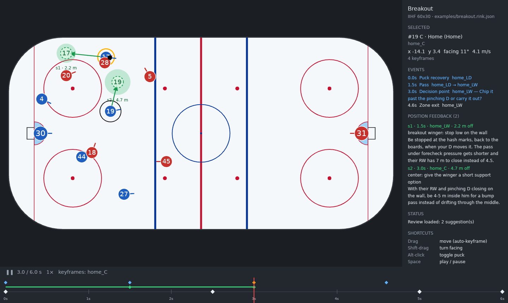

# Rink Replay

A desktop app for recreating real hockey plays as keyframed 2D animations on a to-scale, top-down rink. Your
Claude Code agent then reviews your positioning ("at that moment you should have been there"). The suggestion
appears on the rink as a ghost skating the better route.



**Using it: read the [manual](docs/MANUAL.md).** It covers retracing a play, reviews, working with Claude Code,
and every shortcut.

Plan: [Rink Replay — Hockey Play Animator (Plan)](https://claude.ai/artifact/9v9NCszp1ViTAkhPhGwC1m)

## Status

| Milestone | State |
| --- | --- |
| M0 · Spike: GPUI window, IIHF rink drawn to scale, drag a player | Done |
| M1 · Core + playback: `rink-core` model, `sample()`, keyframes, scrub, play/pause | Done |
| M2 · Editor: multi-row timeline, event editing, templates UI, undo, autosave | Done: text fields, event and roster editing, all-players timeline, play picker, undo/redo, autosave with conflict handling |
| Position feedback: facts, `rink` CLI, Claude Code skill, ghosts in the app | Done (replaces the planned MCP server for now) |

## Layout

```text
crates/
  rink-core/   # model, rink geometry, interpolation (sample), validation, file format, templates
  rink-app/    # GPUI binary: rink-replay
  rink-cli/    # `rink`: JSON facts, timelines and position reviews for agents
rinks/         # rink presets (IIHF 60x30, NHL 61x26) as JSON
examples/      # breakout play with an example review
.claude/skills/   # Claude Code skills: review-positioning, draft-play, team-system
```

`rink-core` has no UI dependency. `sample(play, t_ms) -> Snapshot` is the one function that turns keyframes into
positions. The renderer and the `rink` CLI both use it, so the app and Claude can't disagree about where anyone
was.

## Model in brief

- Rink coordinates are meters with the origin at center ice. +x is home's attacking direction and +y is home's
  left. Time is in milliseconds.
- Skater paths use centripetal Catmull-Rom splines through the keyframes. Facing turns along the shortest arc
  between keyframes that set it; otherwise a skater faces their direction of travel.
- Possession comes only from events, the way you remember a play:
  - a `puck_recovery` gives the puck to a player;
  - a `pass` releases it and the receiver gets it on arrival, unless someone intercepts it first;
  - a `shot` or `whistle` makes it loose;
  - a `turnover` takes it away and can give it to an opponent.

  A loose puck moves in a straight line from its release point to the next pickup, through any puck keyframes on
  the way. In the app, Alt-click a player to give them the puck: it adds a pass from a teammate, a turnover from
  an opponent, or a recovery of a loose puck.
- Each play is saved as one `.rink.json` file with a `schema_version`. Older files are upgraded when loaded, and
  `rink upgrade <play>` rewrites one in the current format. Snapshots are always derived and never saved.
- Each suggestion records a fingerprint of the play's motion. If you edit the play afterwards, the app greys out
  that ghost and marks it "play edited since", and `rink review` reports `"stale": true`. Then ask for a fresh
  review.

## Position feedback

1. **Retrace the play.** Retrace it in the app and mark the decision points (D). The app autosaves.
2. **Ask Claude Code.** In this repo, ask: "review my positioning in <play>". The `review-positioning` skill:
   - reads the play through the `rink` CLI, as computed facts such as zone, strong or weak side, above or below
     the puck, gaps and open pass lanes;
   - judges your positioning at the key moments;
   - writes suggestions to `<play>.review.json` with `rink suggest`.
3. **Every suggestion is checked before it's stored.** The spot must be on the ice and reachable from where you
   really were when the routes split, at 8 m/s or less. The command also prints the facts for where you were next
   to the facts for where you should have been, so you can see what the move changes.
4. **The app picks up the review while the play is open.** Each suggestion shows as a shaded zone at the target,
   a ghost skating the suggested route, an arrow from your real position, and a green bar on the timeline. N and
   Shift-N jump between suggestions, and G toggles ghosts.

Three Claude Code skills in `.claude/skills/` drive this loop:

| Skill | Ask Claude Code | Writes |
| --- | --- | --- |
| `review-positioning` | "review my positioning in <play>" | `<play>.review.json` through `rink suggest` |
| `draft-play` | "draft a play: D-zone breakout, I'm LW strong side, our D rims it and their D pinches" | a new `.rink.json` |
| `team-system` | "set up my team's system" | `system.md` in the library folder, read by reviews |

`rink compare` is a dry run: it shows the facts for any spot without saving anything. Use it to try a spot before
writing a suggestion.

```sh
cargo run -q -p rink-cli -- summary examples/breakout.rink.json
cargo run -q -p rink-cli -- snapshot examples/breakout.rink.json 3000
cargo run -q -p rink-app -- examples/breakout.rink.json      # shows the example review
```

## One window, driven by Claude Code

Keep one app window open and ask Claude Code to load or change plays in it: "show me the ideal version",
"open the breakout", "move their RD to the net front in this play". The agent works on the play files and
then tells the window to show the result:

```sh
rink current                                   # what the window shows: play, playhead, selection, unsaved edits
rink open <play> --at 5500 --select home_LW    # show a play at a moment; reloads it if it's already open
```

- `rink open` writes a request to `.open-request.json` in the library folder. The window checks for new requests
  every 0.75 s. If no window is running, `rink open` starts the app.
- The window doesn't watch play files. It reloads only on `rink open`, so an agent runs it once when it's done
  editing.
- The window autosaves about a second after the last edit, and never overwrites a file that changed on disk since
  it read it: then the edits go to `<play>.your-edits-<time>.rink.json` next to it and a banner asks which version
  to keep.
- The window writes what it shows to `.app-state.json` in the library folder, for `rink current`. With several
  windows open, they all follow every request; one window is the intended setup.

## Build and run

```sh
scripts/install-mac.sh                                 # Rink Replay.app in ~/Applications, rink in ~/.local/bin
cargo run -p rink-app --release                        # the play changed last, or a new breakout
cargo run -p rink-app --release -- --template faceoff  # faceoff | dzone | breakout
cargo run -p rink-app --release -- path/to/play.rink.json
cargo test --workspace                                 # includes headless UI tests on GPUI's test platform
```

Plays live in the library folder: `$RINK_REPLAY_LIBRARY` if set, otherwise `plays/` under the platform data
directory. `scripts/make-icon.sh` regenerates the app icon.

On Linux, GPUI needs these packages (Debian/Ubuntu names): `libxkbcommon-dev libxkbcommon-x11-dev
libwayland-dev libvulkan-dev libx11-xcb-dev libxcb1-dev libfontconfig-dev libfreetype-dev`, plus a Vulkan
driver.

`gpui` is pinned to `=0.2.2` from crates.io instead of a Zed git revision. `Cargo.lock` pins `libc` to 0.2.188
because gpui's `xattr` 0.2 dependency fails to compile against newer `libc` releases.

## Controls

Press ? in the app for the shortcut sheet. The [manual](docs/MANUAL.md#keyboard-and-mouse-reference) has the
full list.

| Input | Action |
| --- | --- |
| Cmd-O | Open a play from the library, or start one from a template |
| Drag, Shift-drag | Move (a keyframe at the playhead, snapped to 100 ms), turn facing |
| Alt-click | Give the puck: a pass from a teammate, a turnover from an opponent, or a recovery |
| D | Decision point at the playhead; type its question |
| Tab, Alt-arrows, Cmd-C / Cmd-V | Select the next player, nudge 0.5 m, copy / paste a position |
| Drag a timeline ◆, A | Retime a keyframe or event; all players in the timeline |
| Space, ← →, Shift ← →, Home / End | Play / pause, step 100 ms, previous / next keyframe, start / end |
| N / Shift-N, G | Next / previous position suggestion, show / hide ghosts |
| Cmd-Z, Shift-Cmd-Z | Undo, redo |
| Pinch, wheel, two-finger scroll, 0 | Zoom, pan, fit the rink |

## Known gaps

- The IIHF preset matches the 2026-27 rule book (60 m, 4.0 m goal lines, 4.5 m circles, neutral-zone spots). Only
  the blue lines' 22.86 m from the end boards comes from secondary sources that quote the rule.
- You can't answer a suggestion in the app yet, for example by dragging the ghost and asking "why not here?".
  Ask in Claude Code instead.
- Team colors and the rink preset have no UI; ask Claude. There are no overlays or command palette yet.
- Pinch zoom works only on macOS. GPUI 0.2 doesn't forward magnify gestures, so
  `crates/rink-app/src/pinch.rs` adds a handler to its AppKit view. Elsewhere, zoom with the mouse wheel or
  Ctrl-scroll.
